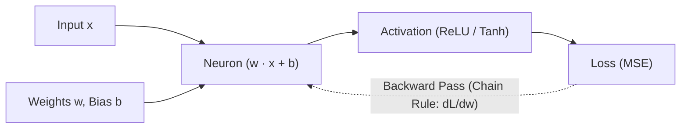

# micrograd 🧠⚡

A lightweight, scalar-valued **reverse-mode automatic differentiation (autograd) engine** and modular neural network library built from first principles in pure Python.

[](https://www.python.org/)
[](LICENSE)
[]()

---

## 🌟 Overview

`micrograd` implements reverse-mode automatic differentiation over dynamically constructed **Directed Acyclic Graphs (DAGs)**. It evaluates mathematical expressions forward and computes exact analytical partial derivatives backward via the multivariable chain rule.

Built on top of the scalar autograd core is a PyTorch-like neural network API (`Neuron`, `Layer`, `MLP`) capable of training multi-layer perceptrons using gradient descent.



---

## 🔬 How It Works

### 1. Reverse-Mode Autograd (`micrograd.engine`)
Every mathematical operation produces a new `Value` node that maintains pointers to its parent inputs (`_prev`) and local derivative functions (`_backward`).

Calling `.backward()` performs a **topological sort** of the computation graph and traverses backwards, accumulating gradients at each node:

$$\frac{\partial \mathcal{L}}{\partial x} = \sum_{y \in \text{children}(x)} \frac{\partial \mathcal{L}}{\partial y} \cdot \frac{\partial y}{\partial x}$$

### 2. Supported Primitive Operations & Gradients
| Operation | Forward Pass | Local Derivative ($\partial \text{out} / \partial \text{self}$) |
| :--- | :--- | :--- |
| **Addition (`+`)** | $\text{out} = x + y$ | $1.0$ |
| **Multiplication (`*`)** | $\text{out} = x \cdot y$ | $y$ |
| **Negation / Subtraction (`-`)** | $\text{out} = x - y$ | $1.0$ (left), $-1.0$ (right) |
| **Power (`**`)** | $\text{out} = x^n$ | $n \cdot x^{n - 1}$ |
| **Division (`/`)** | $\text{out} = x \cdot y^{-1}$ | Multiplied via power & product rule |
| **ReLU** | $\max(0, x)$ | $1.0 \text{ if } x > 0 \text{ else } 0.0$ |
| **Tanh** | $\tanh(x)$ | $1.0 - \tanh^2(x)$ |
| **Exp** | $e^x$ | $e^x$ |

---

## 🚀 Quickstart

### 1. Scalar Autograd Computation Graph
```python
from micrograd.engine import Value

# Define variables
a = Value(2.0, label='a')
b = Value(-3.0, label='b')
c = Value(10.0, label='c')

# Build computational graph
e = a * b
d = e + c
L = d.tanh()

# Backward pass (computes dL/da, dL/db, dL/dc)
L.backward()

print(f"L (output): {L.data:.4f}")
print(f"dL/da:      {a.grad:.4f}")
print(f"dL/db:      {b.grad:.4f}")
```

### 2. Training a Multi-Layer Perceptron (MLP)
```python
from micrograd.nn import MLP

# Create an MLP: 3 inputs, two hidden layers of 4, 1 output
model = MLP(3, [4, 4, 1])

# Sample dataset
xs = [
    [2.0, 3.0, -1.0],
    [3.0, -1.0, 0.5],
    [0.5, 1.0, 1.0],
    [1.0, 1.0, -1.0]
]
ys = [1.0, -1.0, -1.0, 1.0]

# Training loop
for epoch in range(50):
    # Forward pass: predictions and Mean Squared Error loss
    ypred = [model(x) for x in xs]
    loss = sum((yout - ygt) ** 2 for ygt, yout in zip(ys, ypred))

    # Zero gradients
    model.zero_grad()

    # Backward pass
    loss.backward()

    # Gradient descent update
    for p in model.parameters():
        p.data -= 0.05 * p.grad

    if (epoch + 1) % 10 == 0:
        print(f"Epoch {epoch+1:2d} | MSE Loss: {loss.data:.6f}")
```

---

## 📁 Project Structure

```text
micrograd/
├── micrograd/
│   ├── __init__.py       # Package exports
│   ├── engine.py         # Value class, DAG tracking, reverse autograd
│   └── nn.py             # Module, Neuron, Layer, MLP architectures
├── demo.py               # Complete training demonstration script
├── test_engine.py        # Unit tests verifying analytical vs finite-difference gradients
├── requirements.txt      # Zero dependencies (pure Python standard library)
└── README.md             # Project documentation
```

---

## 🧪 Testing

To run the unit tests and verify analytical gradients against finite differences:
```bash
python test_engine.py
```
To run the full end-to-end training demo:
```bash
python demo.py
```

---

## 📄 License
MIT License. Inspired by Andrej Karpathy's pedagogical design for reverse-mode automatic differentiation.
